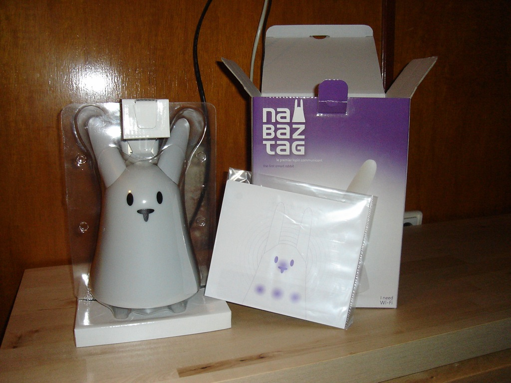

<p align="center">
  
  &nbsp;&nbsp;&nbsp;
  
</p>

<h1 align="center">Nabaztag&nbsp;&nbsp;·&nbsp;&nbsp;Naboot&nbsp;&nbsp;·&nbsp;&nbsp;Le Terrier</h1>

<p align="center">
  <strong>Bring the 2006 Wi-Fi rabbit back to life — new firmware, a new warren, driven from Home Assistant.</strong><br>
  <sub>WPA3 · TLS 1.3 · signed over-the-air updates · a per-rabbit adoption key. The Violet servers died in 2011; this is its new home.</sub>
</p>

<p align="center">
  
  <a href="https://terrier.cyberloutre.fr/"></a>
  <a href="https://github.com/ClaraVnk/terrier-ha"></a>
  
  
  <a href="LICENSE"></a>
  
  
  
</p>

<p align="center">
  
  
  
  
  
  
  <br><sub>every capability above verified live on a real Nabaztag:tag&nbsp;v2 🐰</sub>
</p>

Bring an **original Nabaztag** (the 2005–2006 Wi-Fi rabbit by Violet/Mindscape)
back to life:

- **[Naboot](#flash-naboot--adopt-your-rabbit-on-le-terrier)** is a custom
  firmware for the rabbit — **WPA3**, **XMPP over TLS 1.3**, **signed
  over-the-air updates** and a per-rabbit **adoption key**. You flash it once
  from your phone; every update after that arrives over the air.
- **[Le Terrier](https://terrier.cyberloutre.fr/)** is the hosted "warren" the
  rabbit phones home to, now that the Violet servers are gone (around 2011).
  Adopt your rabbit there — no server to run at home.
- **[The HACS integration](https://github.com/ClaraVnk/terrier-ha)** puts the
  rabbit in **Home Assistant** as devices and entities. It is the recommended
  way to use a rabbit from Home Assistant today.

Rather host everything yourself? This repository is also a Home Assistant add-on
repository whose add-on runs a warren inside Home Assistant, with nothing
flashed — see [The Home Assistant add-on (legacy)](#the-home-assistant-add-on-legacy).

### ✨ Highlights

- 🔧 **Custom firmware — Naboot 1.0.0.0** (2026-11-08, every item
  proven on a real rabbit): **WPA3-SAE**, a per-rabbit **adoption key**
  (X25519, confirmed by five belly colours), **HMAC-signed bytecode**, **XMPP
  over TLS 1.3**, **binary OTA** pushed from the warren's page with the rabbit
  restarting by itself, a crash report in the boot URL, and a modern config UI
  — in 118 344 of 126 976 bytes of flash.
- 🌍 **[Le Terrier](https://terrier.cyberloutre.fr/)** — a public "warren" so
  anyone can adopt a rabbit without running their own server.
- 🧩 **[The HACS integration](https://github.com/ClaraVnk/terrier-ha)** — the
  rabbit as proper Home Assistant **devices and entities** (a light, a switch,
  selects, sensors, buttons) rather than REST calls. It works against Le
  Terrier or against a warren you run yourself, and it is where this project's
  Home Assistant work happens now.
- 📡 **Survives a hostile network** — a tiny firmware mDNS resolver lets the rabbit
  find its server over multicast even when the gateway refuses its unicast DNS.
- 🔁 **Comes back by itself** — restart the server and the rabbit reconnects in
  seconds, base LED violet; lose the access point and it notices and rejoins on
  its own. The old "unplug it" advice is mostly history.
- 🛠️ **A JTAG station in one command** — a Raspberry Pi and five jumpers, no
  probe to buy. `git clone` this repo on the Pi, then
  `firmware-arm/jtag/station.sh setup|check|flash|listen|dump`: un-brick a
  rabbit, write an image and read it back, dump what it *really* runs, or
  watch its live status line without halting it. See
  [`firmware-arm/jtag/README.md`](firmware-arm/jtag/README.md).
- 🗣️ **Talk to Claude through the rabbit** — hold the head button, ask, and it
  answers in its own voice while moving its ears + LEDs. Hands-free **"hey Nabi"
  wake word is in beta** — opt-in and off by default (see the privacy note below).
- 🐰 **Or nothing flashed at all** — with the [Home Assistant
  add-on](#the-home-assistant-add-on-legacy), a stock rabbit with **zero
  hardware mods** just downloads its bytecode from the add-on on boot.
- 🔒 **100&nbsp;% local with the add-on** — bundled whisper.cpp STT + Piper /
  espeak-ng TTS. No cloud, no account, no telemetry.
- 🧩 **Driven from Home Assistant through the add-on** — speak text, play audio,
  original Violet jingles, ear choreographies, RGB light shows, weather / mail /
  air belly icons; button / RFID / ear-move events come back as HA events for
  your automations.

> ✅ **It works end-to-end — verified live on a real Nabaztag:tag&nbsp;v2.** The
> custom **Naboot** firmware (1.0.0.0) adds WPA3, a per-rabbit adoption key,
> signed bytecode, TLS and over-the-air updates; **Le Terrier** is the public
> warren. A stock rabbit is a "dumb" Wi-Fi client that downloads its bytecode on
> every boot (nothing flashed by default) and talks plain HTTP + XMPP. The rabbit
> boots, breathes, speaks, plays jingles, moves its ears, lights up, listens
> hands-free for "hey Nabi", asks **Claude** and answers. The
> **[Roadmap](#roadmap)** below says what is done and what comes next; the
> phase-by-phase story is in [`docs/HISTORY.md`](docs/HISTORY.md).

## Flash Naboot & adopt your rabbit on Le Terrier

> ⚠️ **Flashing is done at your own risk** — no warranty, no liability. A
> failed flash can leave the rabbit unable to re-enter config mode,
> recoverable only over JTAG
> (see [`firmware-arm/docs/RECOVERY.md`](firmware-arm/docs/RECOVERY.md)). Flashing is
> **optional**: a stock rabbit works fine on the
> [Home Assistant add-on](#the-home-assistant-add-on-legacy), with nothing
> flashed.

Put your rabbit on the public warren —
**[Le Terrier](https://terrier.cyberloutre.fr/)** — in four steps:

1. **Download Naboot 1.0.0.0** — the illustrated 5-minute flashing guide is
   at <https://terrier.cyberloutre.fr/naboot>. The image is reproducible: it
   is mode `naboot-1.0.0.0` of `firmware-arm/apply-mods.py`, Ed25519-signed,
   118 344 of 126 976 bytes of flash. The signed file is also in
   [`firmware-arm/releases/`](firmware-arm/releases/)
   (`naboot-1.0.0.0.signed.sim`, with its sha256 and which way in from each
   starting firmware), next to the previous 0.0.0.13 `lean` build and the
   `minimal` rescue build.
2. **Flash it from your phone** via the rabbit's config-mode page: unplug, hold
   the head button while plugging the power back in (belly turns **blue**), join
   the open `Nabaztag-XXXX` Wi-Fi, open `http://192.168.0.1`, tap *firmware
   upgrade* and upload the file. **Don't unplug** during the ~30 s flash. When
   it reboots, the first belly light blinks **orange** while it looks for your
   Wi-Fi: that is expected, and on 1.0.0.0 the rabbit comes back **by itself**
   (measured on an over-the-air install: 54 s from download to boot URL,
   nobody at the plug). Only builds before 2026-11-08 needed a power cycle
   after every flash — their post-flash software reset left the 2006 radio
   asleep — so if you are coming from one and it is still orange after a
   minute, unplug it, wait ten seconds, plug it back in, once.
   This is the only manual flash — from here on, updates are pushed from the
   warren's page and the rabbit installs them and restarts on its own.
3. **Point it at Le Terrier.** After it reboots, re-enter config mode (head
   button while plugging in → belly **blue** again) and reopen
   `http://192.168.0.1` — it now shows *Naboot's* setup page. Enter your home
   Wi-Fi, then under **Advanced → Server** set **Boot URL host** to
   **`terrier.cyberloutre.fr/vl`** and tap *Connect rabbit*. The field holds
   `host/vl`, and the rabbit then requests `http://<that>/bc.jsp`.
   Le Terrier and the add-on both answer whether or not the `/vl` is there,
   so dropping it is survivable here — but keep it anyway: it is the path a
   stock Violet or OpenJabNab server expects, and the one every other document
   about this hardware assumes. No `https://` either, in any case: the 2006
   firmware speaks plain HTTP only. (Running your own warren? Put
   `your-host/vl` here instead.)
4. **Adopt it — the spoken code, then the colours.** On its first boot
   against Le Terrier the rabbit runs a key exchange with the warren (a few
   seconds) and then lights **five colours on its belly for one minute**. It
   is not crashed: it is showing you its key. It then fetches its bytecode,
   connects, and **says its adoption code out loud** (e.g. *“BRAMBLE 4 2”*).
   Sign up on the Terrier and type that code on the **`/pair`** page — the
   rabbit is yours. The warren's page then shows the five colours *it*
   computed and asks whether the belly showed the same: **confirm**, and from
   then on the warren signs that rabbit's bytecode (the rabbit refuses
   unsigned bytecode), its XMPP moves onto TLS, and every update reaches it
   over the air. Until you confirm, the colours come back for a minute at
   every boot — unplug and replug to see them again. *Missed the code? It is
   spoken again on the next connect, but at most once every ~10 minutes per
   rabbit — so wait that long before power-cycling, or you'll get a silent
   boot.*

A rabbit on **Naboot 1.0.0.0** whose owner has confirmed its adoption key runs
its XMPP stream inside **TLS 1.3 (PSK)** on port **5223**, keyed from that
adoption key; the plain port stays for every other rabbit.

> **Nothing happens after step 3 — no code, no voice?** Then the rabbit never
> reached the Terrier, and the firmware is not the first suspect. Check, in
> order: that **Boot URL host** has no `https://` and no typo (a wrong host
> fails silently — though a missing `/vl` is fine here, both forms answer);
> the belly LEDs (**blue** = still in config mode; **orange** = looking for
> Wi-Fi, normal for up to a minute after a flash; **five colours for a
> minute** = the adoption exchange of step 4, wait it out); that your 2.4 GHz
> network lets a 2006 **802.11b** radio in (b rates enabled, no "n/g only");
> on **WPA3**, that the access point allows SAE *hunting-and-pecking* — an
> H2E-only (hash-to-element) setting is not supported yet, WPA3-only and
> WPA2/WPA3 transition both are; and that the rabbit can resolve
> `terrier.cyberloutre.fr` (it needs working DNS). Want
> to go back to the stock bootloader meanwhile? Flash
> **[`firmware-arm/releases/naboot-minimal.signed.sim`](firmware-arm/releases/)**
> the same way — it is the rescue build (`RECOVERY.md`).

> The custom firmware is **optional**: a stock rabbit works fine on the
> [Home Assistant add-on](#the-home-assistant-add-on-legacy) (nothing flashed).
> Naboot is what unlocks **WPA3**, the **adoption key** with signed bytecode and
> **TLS**, **over-the-air updates**, the modern config UI, and dialing a remote
> warren like Le Terrier.

## Home Assistant: the HACS integration

**[The HACS integration](https://github.com/ClaraVnk/terrier-ha)** is the way to
drive a rabbit from Home Assistant today. The rabbit arrives as a **device with
entities** — the belly as a light, sleep as a switch, the nose and the voice as
selects, the mood and the diagnostics as sensors — so it works with the
dashboard, with automations and with voice assistants without a single REST
call. It talks to **[Le Terrier](https://terrier.cyberloutre.fr/)**, the hosted
warren, or to one you run yourself; the address is the only thing to type, and
it is pre-filled.

Add it as a HACS custom repository: `https://github.com/ClaraVnk/terrier-ha`,
category *Integration*.

The other way — [this repository's add-on](#the-home-assistant-add-on-legacy),
a warren inside Home Assistant itself with a REST control API — still works,
but new work goes to the integration and to the warren rather than there.

## Roadmap

The long, dated story of every phase — what was tried, what broke, what was
measured — lives in **[`docs/HISTORY.md`](docs/HISTORY.md)**, unabridged. This
is the short version.

**Done — Naboot 1.0.0.0 (2026-11-08; every item proven on a real rabbit)**

- **WPA3-SAE** — WPA3-only and WPA2/WPA3 transition networks, on 2006 silicon
  (SAE in software, CCMP still in the radio). Hunting-and-pecking only: an
  access point set to H2E-only is not supported yet (see *Later*).
- **Adoption key** — one X25519 exchange at adoption; the rabbit shows five
  belly colours, the owner confirms they match the warren's page. Until
  confirmed, the colours show for a minute at every boot.
  [`firmware-arm/docs/ADOPTION-KEY.md`](firmware-arm/docs/ADOPTION-KEY.md).
- **HMAC-signed bytecode** — a confirmed rabbit refuses bytecode its warren
  did not sign.
- **XMPP over TLS 1.3** (PSK, port 5223) for confirmed rabbits; the PSK is
  derived from the adoption key.
- **Binary OTA** — the update is pushed from the warren's page; the rabbit
  verifies it, installs it and restarts by itself. Nobody at the plug.
- **Crash report** — reset reason and counters in the boot URL, so the warren
  sees what used to need a JTAG read.
- **Self-recovery** — the rabbit notices an access point that forgot it and
  rejoins by itself; a server restart was already survived by the runtime
  bytecode (reconnect, no reboot).
- **Live telemetry over JTAG** without halting the rabbit
  (`firmware-arm/jtag/listen.sh`).
- **The JTAG station in one command** — clone the repo on a Raspberry Pi,
  then `firmware-arm/jtag/station.sh` does setup, check, flash, listen and
  dump. Five jumpers, no probe.
- Also in the image: the modernized config UI, mDNS announcer and resolver,
  the Ed25519 signature gate, and a reproducible build — 118 344 of
  126 976 bytes of flash. Around it: Le Terrier live, the HACS integration,
  the whole-rabbit emulator, and a Metal toolchain in Python whose
  `mtl_comp.py --check` type-checks the real runtime bytecode.

**Next**

- **Per-rabbit wake word** compiled into the bytecode — it is recorded on the
  warren today, but not yet minted into each rabbit's own bytecode.
- **HTTP over TLS-PSK** for the bytecode and OTA fetches — today only the
  XMPP stream is encrypted; the bytecode (HMAC) and the image (Ed25519) are
  authenticated but travel in clear.
- **Close the plain XMPP port** once every rabbit has migrated to TLS.

**Later**

- **H2E** (hash-to-element) for SAE — for access points set to H2E-only, and
  the timing half of Dragonblood.
- **The boot over TLS** — `bc.jsp` and `locate.jsp` over TLS-PSK for a
  rabbit whose adoption key is confirmed (a new image, 1.0.0.2).
- **A JTAG listener that does not stall** — after a few minutes `listen.sh`
  stops on `unknown target request: ff`: openocd's DCC decoder chokes on a
  word starting with 0xff. Either the telemetry never sends one, or the Pi
  reads the DCC channel raw.
- **Reclaim flash** — 8 632 bytes are spare today; the measured savings are
  in the history (Phase 8).
- **`mtl_pyc` typing** — the Python-to-Metal compiler shares `mtl_comp`'s
  code generation but not yet its type checker.

## Hardware

- Tested on the **Nabaztag:tag** (v2, 2006 — mic + RFID). The v1 (2005) likely
  works (same Violet protocol) but is **untested**. The optional **Naboot**
  custom firmware is flashed once from the config-mode upload page, then
  updated over the air, for WPA3, the adoption key, TLS, signed OTA and a
  modern config UI. The Violet add-on drives a **stock** rabbit with no
  hardware mod and **no flashing required**.
- The add-on's host architectures are listed in
  [its section](#host-architecture).

## Troubleshooting

### "After a reboot the belly LEDs are stuck blinking/solid orange — did I brick it?"

**No — don't panic.** Orange (blinking or solid) means the rabbit is *awake and
looking for its Wi-Fi / server*, not dead. A bricked rabbit shows **no** boot
animation at all.

**On Naboot 1.0.0.0, give it a minute or two.** The rabbit comes back on its
own: after a flash or an OTA (measured: 54 s from download to boot URL), after
a server restart (it reconnects, base LED violet, no reboot), and after an
access point that dropped or forgot it (it notices within a few minutes and
rejoins). If it is *still* orange after that, look at the network before the
rabbit: 2.4 GHz with 802.11b rates allowed, DNS for the server name, and on
WPA3 an access point that allows SAE hunting-and-pecking (H2E-only is not
supported yet).

**Five colours on the belly for a minute** is not a fault either: that is the
adoption exchange waiting for you to confirm the colours on the warren's page
(see [*Flash Naboot & adopt*](#flash-naboot--adopt-your-rabbit-on-le-terrier)).
Until you do, it repeats at every boot.

**On a stock rabbit, or a Naboot build from before 2026-11-08,** the old advice
stands: these 2006 radios are flaky at re-associating on boot, and a software
reset leaves the USB radio asleep. Unplug the power, wait ~10 seconds (so it
fully discharges), plug it back in. It then boots → fetches its bytecode →
`locate` → connects → **breathes**. If the first try doesn't catch, do it once
more — it's normal, not a fault.

Tips: it's the Wi-Fi association that's flaky, so a strong signal / 2.4 GHz / a
less crowded channel helps. Don't restart the server (or the add-on) repeatedly
in a short window (each restart drops the rabbit's connection and makes it
re-seek). A `ping` from HA failing is **not** a sign of trouble if the rabbit is
on a different VLAN (cross-VLAN ICMP is usually blocked) — check the warren's
page or the add-on's status/logs instead.

### Telling a real brick apart from Wi-Fi flakiness

| Symptom | Meaning | Fix |
|---|---|---|
| Belly LEDs **blink/glow orange**, boot animation plays | Booted, seeking Wi-Fi/server | On 1.0.0.0: wait a minute or two, then check the network. Stock or older builds: power-cycle (unplug ~10 s) |
| **Five colours** on the belly for a minute, then a normal boot | Adoption key waiting to be confirmed | Confirm the colours on the warren's page |
| **Orange forever** right after WPA3 was turned off on your Wi-Fi (1.0.0.1+) | The rabbit refuses a WPA3 → WPA2 downgrade | Re-save the Wi-Fi settings in config mode (see below) |
| **No LEDs / no boot animation at all**, frozen | Possible bad flash | Config-mode upload (hold head button on power-up → upload a signed `.sim`); otherwise the JTAG station: `firmware-arm/jtag/station.sh flash` |

## Repository layout

```
.
├── firmware-arm/            # Naboot — custom ARM7 firmware, 1.0.0.0. Forks
│   ├── apply-mods.py        #    RedoXyde/nabgcc wpa2: WPA3-SAE, the adoption
│   ├── boot-mods/           #    key, HMAC bytecode, TLS 1.3 PSK, Ed25519-gated
│   ├── crypto/              #    OTA, modernized config UI, mDNS, crash report.
│   ├── pages/               #    Build via ./build.sh --remote HOST --runtime
│   │                        #    {docker,podman} --mode naboot-1.0.0.0 (or
│   │                        #    minimal, lean, …).
│   ├── releases/            #    the signed .sim images + their sha256 (README.md)
│   ├── jtag/                #    ⭐ The JTAG station: a Raspberry Pi as the probe.
│   │                        #    station.sh setup|check|flash|listen|dump
│   ├── emulator/            #    A rabbit that is not a rabbit: the Wi-Fi stack
│   │                        #    run on a build machine against a virtual AP,
│   │                        #    so a fix costs a second instead of unplugging
│   │                        #    the rabbit. `cd firmware-arm/emulator && ./run.sh`
│   └── docs/
│       ├── ADOPTION-KEY.md  #    The per-rabbit key: exchange, colours, HMAC, TLS.
│       ├── BRICK_FORENSICS.md #  Recovery plan + bisection ladder.
│       └── RECOVERY.md
├── bytecode/                # Runtime-side bytecode add-ons (mic stream, mDNS,
│   ├── micstream.mtl        #    OTA, reconnect, the TLS seam) compiled into the
│   ├── fwota.mtl            #    hybrid bootcode served by the add-on / warren.
│   ├── patch_tls.py
│   └── patch_main.py
│                            # (Le Terrier — the public warren at
│                            #  terrier.cyberloutre.fr — lives in a separate
│                            #  private repo; the live site is the showcase.
│                            #  The HACS integration is ClaraVnk/terrier-ha.)
├── docs/
│   └── HISTORY.md           # the phase-by-phase journal (the former Roadmap)
├── repository.yaml          # declares this as an HA add-on repository
├── nabaztag-violet/         # the Home Assistant add-on — our own Violet-protocol server
│   ├── server.py            #    dependency-free Python (HTTP boot + XMPP + control API)
│   ├── config.yaml          #    options (server_address, log_level), ports, arch
│   ├── Dockerfile           #    installs python3, fetches the bytecode at build
│   ├── build.yaml
│   └── DOCS.md              #    install / pairing / API / status
├── legacy/
│   └── nabaztag-server/     # the first OpenJabNab-based add-on — superseded by
│                            #    nabaztag-violet, no longer offered in the store,
│                            #    kept for reference only
├── home-assistant/          # packages for the add-on's REST control API
│   ├── nabaztag.yaml        # ready-to-paste HA package (rest_commands + scripts)
│   ├── ambient.yaml         # ambient automations (belly/ears/nose) over the REST API
│   ├── entities.yaml        # optional dashboard controls (sleep/nose/ears/belly) over REST
│   ├── proactive.yaml       # Nabi "alive" — proactive companion (quips, briefing, notify)
│   ├── nabaztag_tasks.yaml  # standing orders ("préviens-moi quand…") via Claude tools
│   └── rfid.yaml            # RFID tag → action (remembers last tag; dispatches known ones)
├── README.md
└── LICENSE
```

## The Home Assistant add-on (legacy)

This repository is a **Home Assistant OS add-on repository** (`repository.yaml`
at the root). Its add-on, **Nabaztag Violet Server** (`nabaztag-violet/`), is a
small, **dependency-free server that speaks the original Violet protocol**
directly: the rabbit phones home to it, and Home Assistant drives the rabbit —
ears, belly weather icons, nose — through a simple control API. A **stock**
rabbit needs nothing flashed for it.

It still works and it is still here — but the server it embeds is the ancestor
of Le Terrier, and new work goes to the
[HACS integration](#home-assistant-the-hacs-integration) and to the warren
rather than here.

> `legacy/nabaztag-server/` is a different, older add-on: the first one, built on
> OpenJabNab. It is no longer offered in the store and its image cannot be
> patched — if you still have it installed, **uninstall it** (see its
> [`DOCS.md`](legacy/nabaztag-server/DOCS.md)).

### How it works

```
Nabaztag (<rabbit-ip>)  ──HTTP /vl/bc.jsp,/vl/locate.jsp :80──▶  ┌──────────────────────────┐
       ▲                                                          │  Add-on @ <haos-ip>       │
       │                ◀──── XMPP push (commands) :5222 ───────  │  nabaztag-violet (Python) │
       │                ───── XMPP events (button/RFID) ───────▶  │   HTTP boot + XMPP + API  │
Home Assistant  ──── HTTP control API :8099 (/api/...) ─────────▶ └──────────────────────────┘
```

On boot the rabbit fetches its **bytecode** (`/vl/bc.jsp`) and a **locate** file
(`/vl/locate.jsp`) that points it at our server, then opens an **XMPP** stream.
Our server completes the handshake using the documented **SASL success-bypass**
(no Violet password needed), keeps the rabbit idle, pushes `violet:packet`
commands, and **logs everything** the rabbit sends. No OpenJabNab, no reverse
proxy — one clean process.

### Quick start

1. In Home Assistant: **Settings → Add-ons → Add-on Store → ⋮ → Repositories**,
   add `https://github.com/ClaraVnk/nabaztag`.
2. Install **Nabaztag Violet Server**. In **Configuration**, set `server_address`
   to a **hostname** such as `nabaztag.lan` — **not a raw IP**: the bytecode
   resolves the XMPP server by **DNS**, so an IP literal fails. **Start** the
   add-on.
3. **Add a DNS record** so the rabbit resolves that hostname to the HAOS host:
   `nabaztag.lan → <haos-ip>` (UniFi "Local DNS Records", AdGuard/Pi-hole rewrite…).
   Verify from any device: `nslookup nabaztag.lan` → `<haos-ip>`.
4. **Point the rabbit at the server:** hold its head while powering it (LEDs go
   blue), join its `NabaztagXX` Wi-Fi, open `192.168.0.1`, set **Violet Platform**
   to `http://<haos-ip>/vl` (the IP is fine here — boot/locate don't need DNS),
   then *update and start*.
5. Watch the add-on log: `serving bootcode → … → bound and idle — ready for
   commands`. Optionally drop `home-assistant/nabaztag.yaml` into `/config/packages/`.

> Running the server **outside** Home Assistant (a Pi, a VPS)? `python3
> nabaztag-violet/server.py` from a checkout serves the committed
> `nabaztag-violet/bootcode.hybrid` on its own. See `nabaztag-violet/DOCS.md`,
> *Bytecodes — and running the server outside the add-on*.

> **Rabbit on its own VLAN/subnet?** Allow it through the firewall to the HAOS
> host on TCP **80** and **5222**, and give it a **DHCP reservation** (so its IP —
> and the firewall rule — stay valid; a changed IP silently breaks everything). On
> a flat home network there's nothing to do.

Full guide (API, pairing, troubleshooting) is in
**[`nabaztag-violet/DOCS.md`](nabaztag-violet/DOCS.md)**.

### Host architecture

**amd64**. **arm64/aarch64** (Raspberry Pi 4/5) is provisional — the add-on
declares it, but nobody has built or run it on real arm hardware yet. Reports
welcome in [#7](https://github.com/ClaraVnk/nabaztag/issues/7).

### What you can do from Home Assistant

Commands use the two `violet:packet` channels reverse-engineered from the
bytecode — *programs* (`MessagePacket`) for the rich stuff, *ambient*
(`AmbientPacket`) for the at-a-glance indicators:

- 🗣️ make it **speak** any text — **built-in local TTS** (`/api/say`, espeak-ng;
  no cloud, nothing to install)
- 🔊 **play audio** — stream any MP3 or WAV (e.g. a Piper TTS media URL); the
  rabbit fetches it over HTTP from the add-on
- 🎵 **original Nabaztag jingles** — the iconic Violet sounds (extracted from the
  firmware as MIDI, synthesized on the fly): `acquired`, `ack`, `rfid_ok`, …
- 👂 **move the ears** to precise positions (independent left / right) via a
  choreography
- 💡 **RGB light shows** on the 5 LEDs (bottom / left / middle / right / top)
- 🌦️ **belly icons** — weather (sun/cloudy/smog/rain/snow/storm), stock, e-mail,
  air quality &nbsp; 👃 **nose** blink &nbsp; 💤 **sleep / wake**
- 🎤 **talk to it** — hold the head button, ask a question; it transcribes
  (bundled whisper.cpp), asks a **conversation agent (e.g. Claude)**, and speaks
  the reply — which can itself move the ears/LEDs
- 🐇 **give it standing orders** — *"préviens-moi quand la batterie de
  l'aspirateur est pleine"*, *"rappelle-moi de sortir le linge dans 40 minutes"*.
  Nabi remembers, watches the condition (or the clock) and pipes up on its own —
  then forgets the task. See [Give Nabi standing orders](#give-nabi-standing-orders).
- 📟 (v2) react to **button** presses, **RFID/Ztamp** tags and **ears moved by
  hand** — re-emitted as `nabaztag_event` **Home Assistant events** to trigger
  automations (Nabi as an input device)

### Give Nabi standing orders

Beyond one-off questions, you can hand Nabi a **deferred task** in plain French and
let it watch for you:

> *"Nabi, préviens-moi quand la batterie de l'aspirateur est pleine."*
> *"Rappelle-moi de sortir le linge dans 40 minutes."*
> *"Oublie tout."*

Nabi remembers the order, **Home Assistant watches the condition** (a state
threshold, an entity state, or the clock), and the rabbit **announces it on its
own** in Violet's voice once it's met — then forgets the task (single shot, up to
5 at a time).

It works by exposing three scripts as **tools** to your Claude conversation agent
(no add-on change): the spoken request already flows to that agent, which calls
`nabaztag_remember_task` / `nabaztag_remind` / `nabaztag_forget`. A 1-minute
engine in `home-assistant/nabaztag_tasks.yaml` evaluates the stored tasks and
routes the announcement through `script.nabaztag_notify` (so quiet hours still
apply unless the reminder is marked urgent).

**Setup (once):**

1. Drop `home-assistant/nabaztag_tasks.yaml` into `/config/packages/` (it reuses
   `proactive.yaml`'s `script.nabaztag_notify` — install that too).
2. **Anthropic integration → enable "Control Home Assistant"** (the LLM API).
3. **Settings → Voice assistants → Expose** the three `nabaztag_*` scripts **and
   the entities Nabi should watch** (vacuum, washer, weather…) so Claude knows
   their `entity_id`.
4. Reload YAML. Try it by voice, or test from **Developer Tools → Actions**.

### Voice / TTS — make Nabi sound as natural as you like
### Orange after the Wi-Fi went from WPA3 back to WPA2 (1.0.0.1 and later)

Once a rabbit on 1.0.0.1 has joined a network with WPA3 (SAE), it remembers
that this network requires WPA3 and **refuses to join it with WPA2 again**.
That is on purpose: otherwise an attacker could pose as your access point with
WPA2 only and make the rabbit fall back to it (a "downgrade").

So if you turn WPA3 off on that network (or a router update switches a
WPA2/WPA3 transition network to WPA2 only), the rabbit stays **orange** and
never connects. To unlock it:

1. Put the rabbit in config mode (hold the head button while plugging it in,
   release when the light turns blue — not more than 7 s, or it enters the
   factory test mode).
2. Join its Wi-Fi, open its setup page and **save the Wi-Fi settings again**
   (same network name and password are fine).

That save clears the requirement; the rabbit joins over WPA2 and remembers
WPA3 again the next time it gets it. Changing the network name or the
password clears it too. The requirement is stored once per network in the
configuration flash sector, next to the Wi-Fi password.

## Voice / TTS — make Nabi sound as natural as you like

The rabbit's original TTS relied on Acapela's now-dead web service. The add-on
ships its own **fully-local TTS** (`espeak-ng`, robotic but offline) **and** can
speak through **any Home Assistant TTS engine** — so the voice is *your* choice,
from robotic-and-local to Siri/Alexa-natural. Set it in the add-on options:

- **`tts_engine`** — `espeak` (bundled, robotic, 100% local) or **`piper` / `ha`**
  (speak through the HA TTS entity below).
- **`tts_entity`** — when the engine is `piper`/`ha`, *which* HA voice to use.
  Point it at any `tts.*` entity in your Home Assistant:

  | `tts_entity` | Voice | Local? | Naturalness |
  |---|---|---|---|
  | `tts.piper` | Piper (neural, on-device) | ✅ local, free | good |
  | `tts.home_assistant_cloud` | HA Cloud / Nabu Casa | ☁️ (privacy-friendly) | very natural |
  | `tts.elevenlabs` | ElevenLabs | ☁️ paid | the most natural |
  | `tts.google_cloud` / `tts.azure` / `tts.openai` | Google / Azure / OpenAI | ☁️ paid | very natural |
  | (Wyoming) Kokoro / XTTS | newer neural, self-hosted | ✅ local | very natural, more setup |

  Whatever you install in HA appears as a `tts.*` entity — just name it here.
- **`voice_pitch`** — pitch-shift up for a cuter timbre. **`0` is the most natural**;
  `~12–18` is the playful "mignonne" range; `>30` goes chipmunk.

> Privacy note: `espeak` and `piper` stay on your network; the cloud engines send
> the spoken text to a third party. Pick the row that matches your trade-off.

You can also bypass TTS entirely: generate audio elsewhere and hand the rabbit a
media URL via `GET /api/play?url=…` (it decodes MP3 and 22 kHz/16-bit mono WAV),
or `POST` the audio bytes directly and the add-on serves them.

## Credits

- The Violet documentation, mirrored at nabaztag.ovh — the official
  [API v2](https://nabaztag.ovh/doc/v2/APIV2.pdf), the
  [**Metal** language grammar](https://nabaztag.ovh/doc/v2/DT_metal_03_01_13_grammaire.pdf),
  and the Télécom SudParis report that reverse-engineered the v2 boot + XMPP
  protocol ([part 1](https://nabaztag.ovh/doc/v2/InteractionServeurs.pdf),
  [part 2](https://nabaztag.ovh/doc/v2/InteractionServeurs2.pdf)). The old
  `nabaztag.com/doc` index is gone.
- [OpenJabNab](https://github.com/OpenJabNab/OpenJabNab) — reference PHP/C++ Violet
  reimplementation, and where the stock `bootcode.violet` / `bootcode.ojn` are
  fetched from at add-on build time (they are Violet's proprietary firmware and
  are not committed here — see `nabaztag-violet/DOCS.md`, *Bytecodes*).
- [RedoXyde](https://github.com/RedoXyde) (`mtl_linux`, `nabgcc`) and
  [Pixel166](https://github.com/Pixel166) (`nabAsm`/`nabDasm`) — the open Metal
  firmware toolchain that makes Phase 2 possible.

Images: Home Assistant logo © the Home Assistant project. Nabaztag photo by
Catalarem, via [Wikimedia Commons](https://commons.wikimedia.org/wiki/File:Nabaztag1.jpg),
licensed [CC BY-SA 2.5](https://creativecommons.org/licenses/by-sa/2.5).

## License

[Apache License 2.0](LICENSE) — the same license as Home Assistant.
