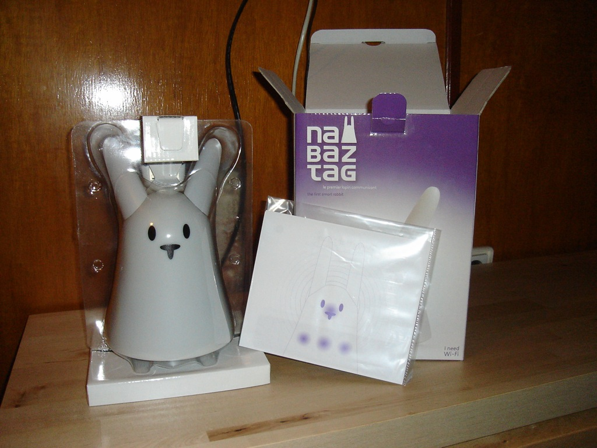
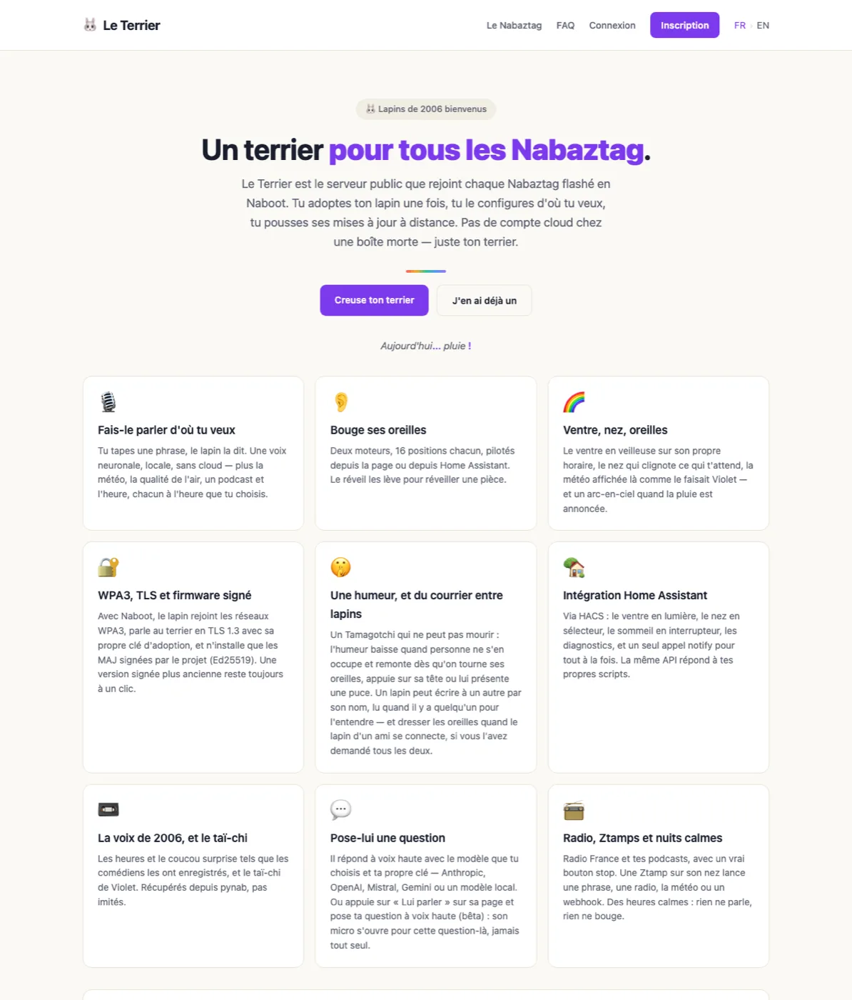
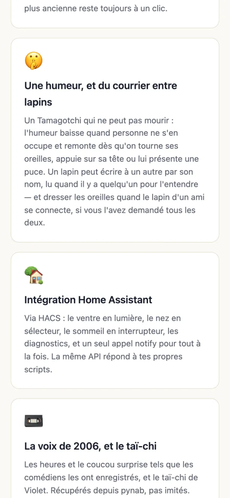
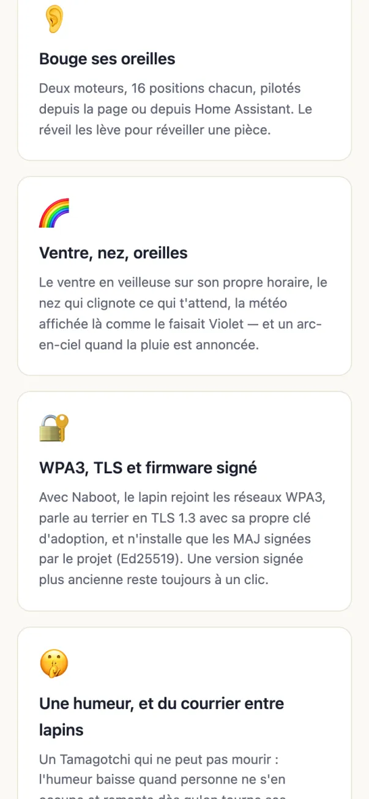
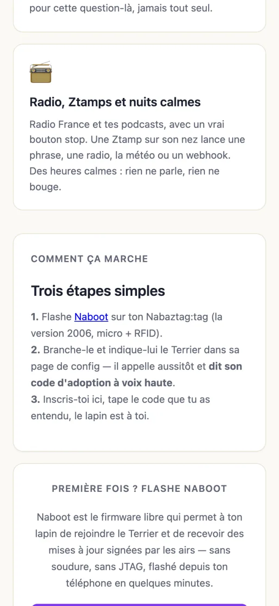

  
  &nbsp;&nbsp;&nbsp;
  

<h1 align="center">Nabaztag&nbsp;&nbsp;·&nbsp;&nbsp;Naboot&nbsp;&nbsp;·&nbsp;&nbsp;Le Terrier</h1>

  <strong>Bring the Wi-Fi rabbits back to life — Nabaztag, Nabaztag:tag and Karotz: new firmware, a new warren, Home Assistant.</strong> 
  WPA3 · TLS 1.3 · signed over-the-air updates · a per-rabbit adoption key.

  
  
  
  

The Violet servers went dark around 2011 and every Nabaztag with them. This
project brings them back:

- **[Le Terrier](https://terrier.cyberloutre.fr/)** — the hosted "warren" the
  rabbits phone home to. Adopt yours there, no server to run at home: Violet's
  services with the 2006 voices, and many new ones.
- **Naboot** — a custom firmware for the Nabaztag:tag: **WPA3**, **TLS 1.3**,
  a per-rabbit **adoption key**, **signed over-the-air updates**. Flashed
  once from your phone.
- **[The HACS integration](https://github.com/ClaraVnk/terrier-ha)** — the
  rabbit in **Home Assistant** as devices and entities.

## Which rabbit?

- **Nabaztag:tag (v2, 2006)** — the rabbit this project was built on, tested
  every day on real hardware. Naboot 1.2.1.4, stable.
  Guide: <https://terrier.cyberloutre.fr/naboot> · details: [`docs/NABOOT.md`](docs/NABOOT.md).
- **Nabaztag v1 (2005)** — beta, on Le Terrier, two ways:
  - **Violet's own firmware**, untouched: point it at the Terrier in its setup
    page, ask for its code by e-mail on the adoption page and hold its head
    down. That page lives on an ad hoc Wi-Fi cell phones and Macs cannot
    join: **a Raspberry Pi with a USB Wi-Fi dongle fills it for you**
    (`firmware-arm/v1-setup/v1-setup.sh find`, then `set --ssid "<network>"`;
    [the tool](firmware-arm/v1-setup/README.md)). Its Wi-Fi knows only WEP or
    open networks: the first real one, adopted on 17 November 2026, joined
    through a phone's hotspot.
  - **Our own firmware** (`firmware-arm/v1-native/`, in C for its PIC18):
    written once with a PICkit over ICSP, the rabbit opened
    (`firmware-arm/v1-icsp/`). Since 25 November 2026 a real v1 (Lazare)
    polls the Terrier on it. The ears, the LEDs, the Terrier's sounds, sleep,
    the head button, ears turned by hand, and its Wi-Fi network and server
    set from the Terrier are proven in the emulator, on Lazare next.

  It has no microphone and no RFID reader.
- **Karotz (v3, 2011)** — works, on Le Terrier, two ways:
  - **Terrier OS** (beta): our build of
    [LapinLibre](https://github.com/sweetlilmre/LapinLibre), written to a USB
    key with Raspberry Pi Imager ([the guide](https://terrier.cyberloutre.fr/karotz);
    `karotz/lapinlibre/`). The Wi-Fi is set in Imager, WPA3 included; the
    Terrier's client is built in; three quick presses on the head open a
    setup network, so a new Wi-Fi needs no USB key.
  - **FreeRabbits OS** with OpenKarotz, and the client installed on it
    (WPA2): the Karotz's original system, brought back by FreeRabbits.

  Terrier OS moves from Linux 2.6.32 to **Linux 6.1 LTS**: it runs on a
  real Karotz (Gengar), started from the USB key, with its USB hub, Wi-Fi
  and the Terrier's client; writing it into the rabbit's flash is the next
  step (`karotz/kernel/`).

  Either way the client adopts it like a v2 (its own key, TLS 1.3), takes the
  same commands, updates itself signed, and sends a Wi-Fi and a diagnostic
  line. Real Karotz are adopted since 16 November 2026
  ([issue #167](https://github.com/ClaraVnk/nabaztag/issues/167)).

Both are supported **only through Le Terrier, and so through the HACS
integration** — not in the Home Assistant add-on. They were built from the
protocols and the code of the projects that ran them, proven in emulation,
then by their first owners; a Karotz (Gengar) and a v1 (Lazare) are now here too. If
you have a v1, the Terrier is the way in, and your feedback is what takes it
out of beta.

Guides: [v1](https://terrier.cyberloutre.fr/v1) ·
[Karotz](https://terrier.cyberloutre.fr/karotz) ·
[manual](https://terrier.cyberloutre.fr/manuel) ·
[FAQ](https://terrier.cyberloutre.fr/faq).

## Home Assistant

**[The HACS integration](https://github.com/ClaraVnk/terrier-ha)** is the way:
add `https://github.com/ClaraVnk/terrier-ha` as a HACS custom repository,
category *Integration*. It talks to Le Terrier or to a warren you run yourself.

This repository is also a Home Assistant add-on repository, whose add-on runs a
warren inside Home Assistant for a stock rabbit, nothing flashed. It still
works, but new work goes to the integration and the Terrier:
[`docs/ADDON.md`](docs/ADDON.md).

## Le Terrier, in pictures

  

  
  &nbsp;
  
  &nbsp;
  
   Le Terrier on a computer and on a phone. Mobile first, light and dark themes.

## Documentation

| | |
|---|---|
| [`docs/FEATURES.md`](docs/FEATURES.md) | everything it does, in detail |
| [`docs/NABOOT.md`](docs/NABOOT.md) | flash Naboot, adopt, troubleshoot |
| [`docs/ROADMAP.md`](docs/ROADMAP.md) | what is done, what comes next |
| [`docs/HISTORY.md`](docs/HISTORY.md) | the dated story of every phase |
| [`docs/RUNBOOK.md`](docs/RUNBOOK.md) | every tool from a shell: build, sign, test, emulate, release |
| [`docs/DIAGNOSTIC.md`](docs/DIAGNOSTIC.md) | reading a rabbit's diagnostic |
| [`docs/REPOSITORY.md`](docs/REPOSITORY.md) | what lives where |
| [`docs/ADDON.md`](docs/ADDON.md) | the Home Assistant add-on (legacy) |
| [`firmware-arm/docs/RECOVERY.md`](firmware-arm/docs/RECOVERY.md) | bringing a rabbit back |

Found a bug, have a v1 or a Karotz to test?
[Open an issue](https://github.com/ClaraVnk/nabaztag/issues).

## Credits

- The Violet documentation, mirrored at nabaztag.ovh — the official
  [API v2](https://nabaztag.ovh/doc/v2/APIV2.pdf), the
  [**Metal** language grammar](https://nabaztag.ovh/doc/v2/DT_metal_03_01_13_grammaire.pdf),
  and the Télécom SudParis report that reverse-engineered the v2 boot + XMPP
  protocol ([part 1](https://nabaztag.ovh/doc/v2/InteractionServeurs.pdf),
  [part 2](https://nabaztag.ovh/doc/v2/InteractionServeurs2.pdf)). The old
  `nabaztag.com/doc` index is gone.
- [OpenJabNab](https://github.com/OpenJabNab/OpenJabNab) — reference PHP/C++ Violet
  reimplementation. Its Violet bootcode sources, from which every runtime here
  is built, are vendored in `firmware-arm/vendor/openjabnab/`, and the stock
  `bootcode.violet` / `bootcode.ojn` in `nabaztag-violet/vendor/openjabnab/`, so
  nothing breaks if that repository disappears.
- [RedoXyde](https://github.com/RedoXyde) (`mtl_linux`, `nabgcc`) and
  [Pixel166](https://github.com/Pixel166) (`nabAsm`/`nabDasm`) — the open Metal
  firmware toolchain that makes Phase 2 possible.
- [LapinLibre](https://github.com/sweetlilmre/LapinLibre) by sweetlilmre — a
  free Karotz firmware built from source, and a replacement for Mindscape's
  platform server; [dirk-thomas/karotz](https://github.com/dirk-thomas/karotz)
  — the Karotz's `Voos-message.proto`. The reference for
  `firmware-arm/emulator/karotz/fros/`.

Images: Home Assistant logo © the Home Assistant project. Nabaztag photo by
Catalarem, via [Wikimedia Commons](https://commons.wikimedia.org/wiki/File:Nabaztag1.jpg),
licensed [CC BY-SA 2.5](https://creativecommons.org/licenses/by-sa/2.5).

## License

[Apache License 2.0](LICENSE) — the same license as Home Assistant.
