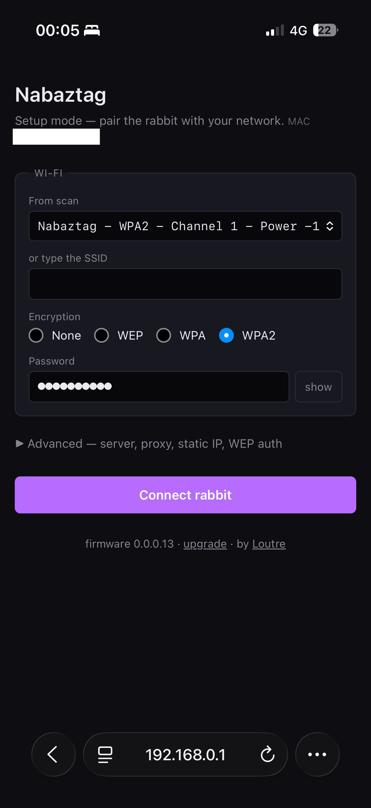
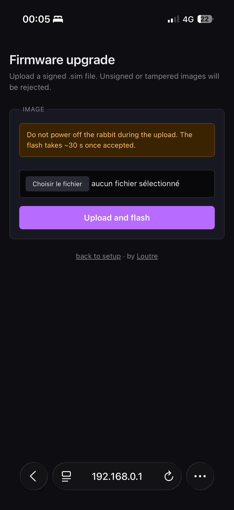

# History — how the rabbit came back, phase by phase

This is the project's journal, moved here unabridged from the README's
former *Roadmap* section when Naboot 1.0.0.0 shipped (2026-11-08). It is the
long version: what was tried, what broke, what was measured, and the dates.
The short version — done / next / later — is the **Roadmap** in the
[README](../README.md).

Each phase below is written as it stood when it was written; where a later
measurement corrected an earlier claim, the correction is in the text next
to it rather than edited over it.

- **Phase 1 — working (verified live):** the rabbit boots our bytecode, completes
  the full XMPP handshake (incl. answering its `violet:iq:sources` query with an
  init packet), becomes operational (`idle`) and **breathes**. It receives binary
  **AmbientPacket** commands (ears, belly weather/stock/mail/air-quality icons,
  nose) and sleep/wake. Connection + command pipeline confirmed on the real device.
- **Phase 1.5 — working (verified live on the device):** the rich command channel
  runs end-to-end. The rabbit **speaks** (built-in espeak-ng TTS), **plays audio**
  (MP3 and WAV), **moves its ears** to precise positions and runs **RGB light
  shows** — pushed as `MessagePacket` programs whose audio/choreography resources
  the rabbit fetches back over HTTP from the add-on. Getting here needed two
  protocol fixes: the server must answer the rabbit's **presence** (so it reaches
  the `ssFree` state where it executes pushed commands) and must not let `<unbind>`
  be mistaken for a bind. A ready-to-use Home Assistant package (incl. a
  *speak Claude's reply on the rabbit* script) ships in `home-assistant/`.
- **Phase 2 — voice → Claude — working (verified live), no firmware hacking:**
  the stock bytecode already does **push-to-talk** — hold the head button, speak,
  and it records the mic and POSTs the audio to `/vl/record.jsp`. The add-on
  decodes it, runs **bundled whisper.cpp** for speech-to-text, sends the text to a
  **Home Assistant conversation agent** (e.g. the Anthropic/Claude integration),
  and speaks the reply back. The agent can also **drive the rabbit** by embedding
  `[ears …]` / `[led …]` / `[nose …]` tags in its reply. TTS is bundled **espeak-ng**
  or, for a much nicer voice, **Piper** via the HA Piper add-on. Enable it with the
  `voice_pipeline` / `conversation_agent` / `tts_engine` options.
- **Phase 3 — wake word — beta (opt-in, off by default):** push-to-talk is
  stable and needs no firmware change; the hands-free wake word ("hey Nabi") is
  **beta** — always-listening is opt-in and **off at source by default** (the mic
  does not stream until you turn it on; turning it off stops capture at the
  rabbit, not just server-side). It works end-to-end but the wake-word accuracy
  and barge-in handling are still being tuned. The stock firmware
  only records the mic on a physical button press — the server can't start a
  recording. So passive listening required a **custom mic-streaming bytecode**.
  Solution: a *hybrid* bytecode that adds a server-triggered **UDP microphone
  stream** (`firmware/micstream.mtl`, à la `openab`) to the stock Violet
  bytecode, compiled with RedoXyde's `mtl_linux` in a Linux x86 container.
  Server-side `wake_loop` swaps the audio buffer every few seconds, runs bundled
  whisper.cpp, and if "Nabi" is heard, the rest of the utterance is sent to the
  conversation agent and the reply spoken back. Confirmed live: "Nabi, raconte
  une blague" → Claude reply spoken full-voice in the Piper voice with action
  tags driving ears + LEDs simultaneously.
- **Phase 4 — firmware upgrades — done (Naboot, hardware-verified
  2026-06-20):** with the toolchain stood up, built **Naboot**, a fork of
  `RedoXyde/nabgcc` (wpa2 branch) compiled as a `.sim` flashable via the
  config-mode upload page (no JTAG / no opening). Adds an **Ed25519-gated OTA**
  path (`verifySig` opcode 152 + `flashFirmware` gated on signature against
  `firmware-arm/keys/signing_pubkey.h`), strips the upstream debug `printf`
  glue, and wraps the linker script's vector / startup / bytecode sections in
  `KEEP()` so `--gc-sections` is safe to enable. Build is reproducible from
  the pinned upstream commits (`nabgcc` `2c05b53f`, `mtl_linux` `7e557a15`).
  Status (2026-06-20): **brick root-caused and fixed.** It was a linker bug,
  not a Naboot mod — `-fdata-sections` splits `.bss` into per-variable `.bss.*`
  sections that the nabgcc linker (`sys/ml67q4051.ld`) left outside
  `__bss_start__..__bss_end__`, so the startup zero-loop never cleared them →
  garbage globals → Data Abort at boot. This hit *every* mode (even
  `minimal`/vanilla), which **exonerates `modernize_pages`** (the original
  suspect). The *first* fix (`97e05d1`) bracketed `*(.bss .bss.*)` so the
  zero-loop clears all of it — and bricked the rabbit, because on a 16 KB
  SRAM the collected `.bss` runs into the 0x1680 bytes of stacks that
  `init.s` reserves from the top of RAM. The stop-gap (`3cd45d8`) reverted
  the bracket and forced the one global that actually faulted — the audio
  FIFO indices `play_w`/`play_r` — into `.data` (init 0), so
  `audioPlayFetchByte()` can't read a garbage index before
  `audioPlayStart()` runs.

  **Settled on 2026-10-27** (`extbss`, PRs #61 and #63), and the way it was
  wrong for four months is the part worth keeping. The note next to that
  revert said bracketing `.bss.*` left *zero VM heap* and stalled the
  bytecode loader. It does not: `VMALLOC` never touches the newlib heap —
  `_vmem_heap` is a fixed address in external RAM (`inc/vm/vmem.h:16`) — and
  the brick was `.bss` landing on the stacks. Believing the wrong mechanism
  argued against the right fix, which is to stop keeping 8 KB of pure
  scratch in a 16 KB SRAM: `audioFifoPlay` and vlog's `buffer_temp` now live
  in a NOLOAD `.extbss` in external RAM (ported from RedoXyde/nabgcc
  `6303737`, Léonard/uplg), `.bss.*` is collected properly, and the user
  stack goes from 1 916 to **10 104 bytes** of headroom. Every EAPOL global
  — `pmk`, `ptk`, `gtk`, `anonce`, `snonce`, `replay_counter` — is zeroed at
  boot now instead of starting on whatever the SRAM held, which is what made
  association partly a dice roll on each replug. `preflight.py` gained the
  checks that would have caught the 2026-06-20 brick, and the ones that
  caught a second attempt at it on 2026-10-25. Recovered
  with a **Raspberry Pi as a bit-bang JTAG adapter** (no probe, F/F Dupont to
  the 8-pin header) + a TCL reimplementation of the OKI ML67Q4051 flash
  sequence on stock OpenOCD; flash read/erase/program verified byte-exact.
  Both `minimal` and the full **`lean`** build (modernized pages + sig-gated OTA
  + mDNS) now **boot and run** on the rabbit — JTAG confirms it executes in User
  mode with a live main loop, no longer the Abort dead-loop. See
  `firmware-arm/RECOVERY.md` and `BRICK_FORENSICS.md`. Six pre-built variants:
  `minimal` (rescue, vanilla bootloader +
  verifySig only), `signed-stock` / `pages-only` / `mdns-only` (isolation
  bisects), `full` (sig-gated OTA + modernized UI), `max` (`full` + boot-side
  mDNS), `lean` (`max` + `--gc-sections`).
- **Phase 5 — setup UX — done (hardware-verified 2026-06-21):** rewrote the four
  config-mode HTML pages (`page_a / page_done / page_u / page_error`) in
  modern semantic HTML with a dark theme, mobile viewport, and the same form
  field names + template markers the firmware backend expects, so the existing
  `cbhttp` / `httpindex` / `httpflash` paths in `boot.0.0.0.13.mtl` keep
  working unchanged. Saved ~5 KB of ROM in the process. Source HTML lives
  under `firmware-arm/pages/`; injection into the boot bytecode is done by
  `firmware-arm/apply-mods.py:modernize_pages`. The modernized pages, rendered
  on a real rabbit (the `lean` build) from a phone at `192.168.0.1`:

  

    
    &nbsp;&nbsp;
    
  

- **Phase 6 — Le Terrier — DONE (live at https://terrier.cyberloutre.fr/):**
  the public warren every Naboot rabbit dials back to. Dependency-free Python
  (stdlib + Flask for the owner UI), deployed on Loutre's VPS via a rootless
  Podman quadlet behind Caddy 2 (auto-Let's-Encrypt). Reachable from any
  network: `/vl/locate.jsp` → ping/broad/xmpp_domain, `/vl/bc.jsp` →
  signed `.hybrid` baseline bytecode (104 824 B), XMPP `:5222` published
  direct (the rabbit hardware has no TLS, so Caddy stays on the HTTP/HTTPS
  layer). The owner UI is FR/EN, has Open Graph + Twitter card metadata (so
  the link previews cleanly in iMessage), and walks an owner through signup
  → claim → pair → drive in three steps. Multi-tenant per-MAC state in
  SQLite; per-owner / per-rabbit accounts; ProxyFix so HTTPS canonical URLs
  resolve cleanly behind Caddy. **Adoption is wired up:** an unclaimed rabbit
  that dials in mints a pair code and **says it out loud** ("BRAMBLE 4 2") so its
  human can claim it on `/pair`; the on-device **download + flash + adopt guide**
  is at [`/naboot`](https://terrier.cyberloutre.fr/naboot). Still on the list:
  per-rabbit bytecode minting (every paired rabbit gets the same baseline today).
  The Terrier **source now lives in a private repo** (it carries the warren's
  state); the live site is the showcase. **Naboot is the firmware on the rabbit;
  Le Terrier is the home they all dial back to.**
- **Phase 7 — modernize the Metal toolchain in Python (in progress, working v1 shipped):**
    Toolchain landed (all in `firmware-arm/tools/`):
    - **`mtl_dis.py`** — disassembler. Decodes all 153 opcodes,
      reconstructs globals, resolves jump targets, annotates `OPexec`
      callsites with names (via `--src boot.0.0.0.13.mtl`), auto-strips
      the `amber<hex>...Mind` HTTP wire wrapper. Outputs text, JSON, or
      `--format masm` for re-assembling.
    - **`mtl_dis.py --check`** — structural validator. Refuses
      bins with unknown opcodes, out-of-range jump targets, OPexec to
      out-of-range fun indices, or funtable entries outside the code
      section. Should gate every freshly-built `.sim` before flash.
    - **`mtl_asm.py`** — bytecode encoder. Library API + line-oriented
      `.masm` text format. **Validated byte-for-byte against the C++
      `mtl_compiler`** on real production bytecode: full `bin → .masm
      → bin` round-trip on `boot.0.0.0.13.bin` (31 437 B) and
      `bootcode_hybrid.bin` (103 525 B, 459 functions).
    - **`mtl_comp.py` — `.mtl` source compiler.** Recursive-descent
      parser + codegen that emits byte-identical `.bin` to the C++
      `mtl_compiler` for the supported subset (proto / var / const /
      fun, integers, strings, builtins, user-fun calls, arithmetic
      and comparison, if/then/else, let-in, set, sequencing). Tested
      byte-for-byte on 23 progressively richer programs, the largest
      344 bytes. It has never compiled a real Violet source — see
      Phase 7a below for where it stops and what closing the gap
      would buy.
    1. **Phase 7a — Python MTL compiler (code landed, not yet able to
       build the real thing):** `mtl_comp.py` exists and emits
       byte-identical bytecode to the C++ `mtl_compiler` on 23 test
       programs — the largest of which is 344 bytes. On 2026-11-08 it
       was pointed at the real preprocessed `bootcode.mtl` (10 677
       lines, the exact input the C++ compiler had just turned into a
       105 KB image) and stopped twice in two minutes:

       - `i32 operand out of range: 281474959933440` — `0xFFFFFF000000`,
         one of MD5's 48-bit masks. The C++ compiler truncates to 32
         bits; this one raises.
       - `line 466: unknown field '('` — `set md5bloc.(j*2) = …`,
         computed array indexing. `.field` on a struct is supported,
         `.(EXPR)` is not.

       Neither is research; both are constructs the 2006 sources use and
       the Python compiler has never seen, because it has only ever been
       run on its own tests. **The milestone that retires the C++ binary
       is one command**: compile the real `bootcode.mtl` and have `cmp`
       report byte-identical against the reference image. Until then the
       32-bit `mtl_compiler` is still the only thing that can build a
       bytecode, inside a Debian container with `libc6:i386`.
    2. **Phase 7b — "view as Python" layer (code landed, blocked on 7a):**
       `mtl_pyc.py` compiles a Python subset straight to Metal bytecode via
       the stdlib `ast` module, and `mtl_depyc.py` renders bytecode back as
       Python. So the contributor-facing surface already is Python. It is
       only worth relying on once 7a can build the real sources, since
       `mtl_pyc` shares `mtl_comp`'s codegen and therefore its gaps.
    3. **Phase 7c — put the toolchain under test (not started):** these
       four tools are 4 500 lines and **nothing in CI runs any of them**.
       `mtl_asm`/`mtl_dis` round-trip the real 103 KB bytecode
       byte-identically, which is the strongest guarantee in the set and is
       checked by hand. The regression test that matters is the 7a
       milestone itself — compile the real source, compare to the
       reference image — so 7c is mostly 7a's test, wired up.
- **Phase 8 — shrink the firmware by moving boot-bytecode logic to C
  (prototype landed):** the rabbit's bootloader is ~3000 lines of Metal
  bytecode (`mtl/boot/boot.0.0.0.13.mtl`) running on top of a tiny stack VM.
  Native ARM is roughly 3× denser than Metal bytecode, so rewriting boot-side
  hot paths in C — and stripping the corresponding VM opcodes — would free
  10–20 KB of ROM (the flash budget is 124 KB and `max` uses ~92%).
  **Scope clarification:** Phase 8 only touches the **boot bytecode**, which
  is already inside the `.sim` and already requires a flash to change. It
  does **NOT** touch the runtime bytecode (`firmware/*.mtl`), which is
  downloaded fresh from the server on every boot and stays OTA-instant.
  **`phase8-rom` build mode** stacks 8 source-level slices on top of
  `lean`: (1) the 4 config-portal HTML pages move from Metal globals
  into a C-side `const char[]` and render through a new `OPpageRender`
  opcode; (2) `pagefill`/`listreplacestr` and 4 stillborn helpers
  pruned as orphans after rom_pages obsoleted their callers;
  (3) `mkwav 8000 1 16` precomputed at build time and inlined as a
  46-byte literal; (4) `dump`/`dumpscan` reduced to identity, callsites
  inlined, defs dropped; (5) all 86 `Secho{ln} "literal"` calls
  replaced with `nil`; (6) user echo helpers `MACecho`/`SEQecho`/`IPecho`
  collapsed to identity (return-value contract preserved); (7) every
  dynamic-arg `Secho`/`Iecho`/`{ln}` opcode keyword deleted — verified
  as pure stack passthroughs in vinterp.c; (8) every prior slice
  composable + idempotent. The resulting `.sim` is **220 330 B —
  17.9 KB smaller than minimal/rescue (238 706 B), 6.2 KB smaller
  than the previous best (`lean` at 226 658 B)** — and ~10 KB of
  vmem RAM is freed at runtime. The remaining big bytecode is
  concentrated in stateful paths (`loop`, `cbnettcp`, `tcpwrite`,
  `tcpevent`) where C rewrites would require hardware-tested validation;
  this stack stays at the safe envelope.
  **Measured again on 2026-11-08, against `lean-wpa3` (117 692 B of a
  126 976-byte flash):** `rom_pages` no longer stacks — it and `wpa3_boot_pw`
  both take opcode 153 — and it would not save flash anyway, since the pages
  have to be stored either way (9 246 B of the 13 602-byte globals block).
  Of the bytecode slices, `strip_secho` is worth 2 036 B (twice the claim),
  `strip_dump` 517 B, `inline_mkwav` 105 B (not ~520), the echo opcodes 146 B
  and the echo helpers 214 B; the whole bytecode bundle plus five unreferenced
  functions is 2 880 B, not 6 KB. The real weight was on the C side: the
  console's `sprintf` and thirteen `sprintf(dbg_buffer, …)` calls whose
  `DBG_*` consumer compiles to nothing kept newlib's printf core and nano
  malloc in every "lean" image — 5 680 B. With those, a loop-form MD5
  (1 656 B) and one AES S-box instead of two (256 B), **`lean-wpa3-slim`
  is 107 228 B, 19 748 spare**, same behaviour, not yet on hardware (the
  steps edit the console and USB files, see `RECOVERY.md`). Compiling at
  `-Os` would take another 10 112 B off `lean-wpa3` but rewrites every
  function of a flag-validated image, so it is measured and not proposed.
- **Phase 9 — gateway-independent resolution (mDNS) — done, Claude live on the
  recovered rabbit (2026-06-21):** after the un-brick the rabbit booted and
  reached XMPP, but the home gateway **silently dropped its unicast DNS** — a
  per-client ACL / DNS-flood guard, *proven* with a control test: the same
  `A? <name>` query is answered for other hosts and refused only when the source
  IP is the rabbit's. So it could never resolve its server and stayed all-orange.
  Rather than touch the firewall, taught the rabbit to resolve over **multicast
  mDNS**: `firmware/mdnsresolve.mtl` + `patch_dns.py` make the runtime bytecode's
  `dnsreq` route `.local` names to `224.0.0.251:5353` instead of the gateway —
  **no flash** (runtime bytecode, served fresh by `bc.jsp`). The rabbit queries
  from port 1597, so an RFC 6762 §6.7 responder answers it as a legacy unicast
  query and the existing response path parses it unchanged. `locate` returns
  `nabaztag.local`; a standard mDNS responder (`nabaztag-violet/tools/nabmdns.py`,
  no spoofing) answers it. Confirmed live: fresh boot → multicast resolve → full
  XMPP bind → **the whole Phase 2 voice loop runs on the recovered rabbit**
  (button → whisper → Claude → Piper TTS, spoken full-voice with ears/LED action
  tags). No gateway DNS, no reply-spoofing. The unicast fallback (`nabdns.py`,
  for stock un-patched bytecode) and the deploy steps live in
  `nabaztag-violet/tools/DNS-HELPER.md`.

- **Phase 10 — the rabbit reconnects instead of rebooting — done
  (hardware-verified 2026-10-20):** every server restart — a deploy, a crash,
  a Home Assistant update — left the rabbit orange until someone unplugged it.
  The cause was not a missing recovery: stock Violet bytecode *does* recover,
  by rebooting the rabbit when the XMPP socket closes
  (`main.mtl:XmppGateStreamClosed`), and its own comment says the authors
  weighed reconnecting gently and chose the reboot as *"le plus efficace"*.
  Measured on the device: the drop is logged at 17:12:12, the rabbit reboots
  and re-downloads its 103 KB of bytecode at **17:12:25** — so the reboot path
  fires — and then stops, never even asking for `locate.jsp`. **A soft reboot
  does not bring the 2006 rt2501 USB radio back; a power cycle does.** That
  also kills the "watchdog that reboots" idea we had queued since June: it
  would have failed the same way.
  So take the branch Violet declined — `firmware/patch_reconnect.py` routes the
  closed socket to `XmppSessionIsDisconnected`: stop, reset to idle, base LED
  violet, wait 5 s plus a random 0-30 s (so a whole warren does not stampede
  back at once), then `XmppGateReconnect`. The network stack is never torn
  down, so there is nothing to bring back. It ships in the **runtime bytecode**,
  downloaded at every boot — **no flashing, no brick risk**, and the firmware
  image is untouched. A control build without the patch comes out at 104 827 B,
  exactly the size documented here, against 104 824 B with it: three bytes.
  **Proven live:** disconnect 19:41:12 → connect 19:41:25 → operational
  19:41:26 → probe 254 ms, with **no boot event in between**.
  Found on the way: the bytecode being served had 459 functions instead of 468
  — it had been built **without the mDNS resolver** of Phase 9. The rebuild
  restores it.
  *Still open:* a rabbit that loses its Wi-Fi **association** is a different
  failure, and this does not cover it. `wifi.mtl`'s `reconnectW` only calls
  `wifiAuth`, which authenticates against the scan **cached at boot** and never
  re-scans — only a cold start does. That is why an AP deauth strands the
  rabbit with amber LEDs until it is unplugged. Diagnosed, not yet patched: it
  cannot be tested without hardware that reproduces it.
