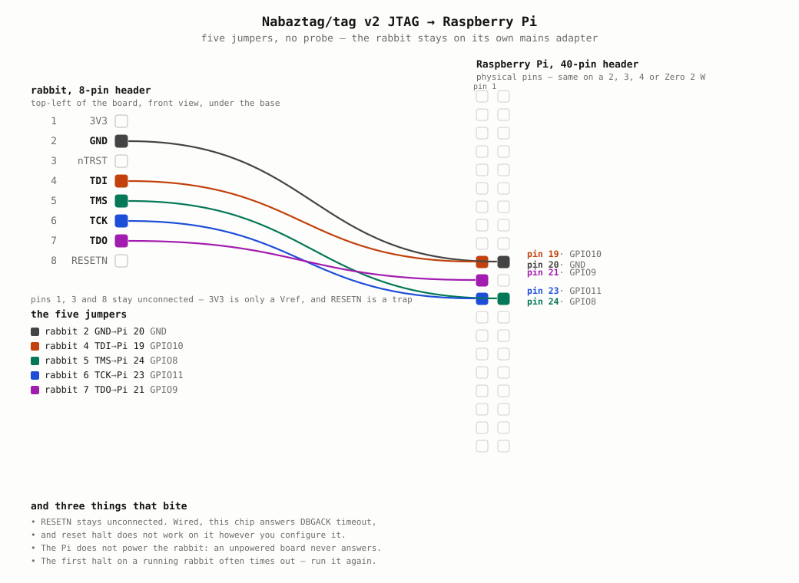

# The JTAG station

A Raspberry Pi as the probe, five jumpers, no J-Link. This is how a bricked
Nabaztag/tag v2 gets its firmware back — and, more often useful, the only way
to find out what firmware a rabbit is *actually* running.

That second use is not hypothetical. On 2026-11-07 a dump showed a rabbit
running a build from 21 June, byte-exact, after five months of flashes that
had all reported success. Nothing else in this project could have told us.

## Quick start, on the Raspberry Pi

```
sudo apt-get install -y git                    # Raspberry Pi OS Lite has none
git clone https://github.com/ClaraVnk/nabaztag && cd nabaztag
./firmware-arm/jtag/station.sh setup          # once, then log out and back in
./firmware-arm/jtag/station.sh check          # JTAG answers and the flash reads back
./firmware-arm/jtag/station.sh flash firmware-arm/releases/naboot-1.0.0.3.signed.sim
                                              # verify, write, read back, compare
./firmware-arm/jtag/station.sh listen         # the live status line, no halt
./firmware-arm/jtag/station.sh dump out.bin   # what the rabbit really runs
```

`flash` takes a release as published, the signed `.sim`: it checks the
signature with the project key, takes the plain image out of it and writes
that. A `.sim` written as it is would leave the chip nothing to boot. It also
takes a plain `Nab.bin` from a build, and refuses any file that does not
start with the ARM vector table. The link rarely lasts a whole image, so
before every pass it reads the flash and writes only what is missing: an
interrupted pass is not lost, and running the same command again resumes
where it stopped. Unplug and replug the rabbit afterwards.

`listen` needs a firmware built with the `dcc_telemetry` step (mode
`lean-wpa3-tel`); the fields are explained in `listen.sh`. Everything else
works on any rabbit, bricked or not.



The picture is generated: `./mkwiring.py -o wiring.svg`.

## What is here

| file | what it is |
| --- | --- |
| `wiring.svg` / `mkwiring.py` | the five jumpers, and what draws them |
| `station.sh` | the one command: setup, check, flash, listen, dump |
| `setup-station.sh` | provisions a fresh Pi: packages, group, GPIO bank check |
| `nabaztag-pi.cfg` | OpenOCD: linuxgpiod adapter, ARM7TDMI target, no SRST |
| `oki.tcl` | the OKI ML67Q4051 flash sequence — id, dump, erase, program |
| `mkfwprog.py` | turns a `Nab.bin` into the TCL that writes it |

`oki.tcl` is reconstructed from the firmware's own writer,
`write_uc_flash_sec()` in nabgcc `src/utils/mem.c` — the same unlock
addresses, commands and completion test the rabbit uses on itself. Stock
OpenOCD has no driver for this part, and RedoXyde's patched 0.8.0, which
does, cannot drive a Pi's GPIO: it predates linuxgpiod and modern kernels
dropped the sysfs interface it used.

## Wiring

The rabbit's 8-pin header is at the **top-left** corner of the board, rabbit
seen from the front, reachable after the four tri-wing screws of the base.

```
   rabbit                           Raspberry Pi (40-pin header)
   ------------------------------   ----------------------------
   1  3V3  (Vref)   leave unconnected
   2  GND                           pin 20
   3  nTRST         leave unconnected
   4  TDI                           pin 19   GPIO10
   5  TMS                           pin 24   GPIO8
   6  TCK                           pin 23   GPIO11
   7  TDO                           pin 21   GPIO9
   8  RESETN        leave unconnected  (deliberately — see below)
```

Pin numbers are physical and identical on a Pi 2, 3, 4 or Zero 2 W. A Zero 2 W
is slower per GPIO round-trip; nothing else changes.

**The rabbit stays on its own mains adapter.** The Pi drives five logic lines
and nothing else — it does not power the SoC, and an unpowered board does not
answer JTAG.

## Setting the Pi up

```sh
scp -r jtag pi-host:~/nabaztag-flash
ssh -t pi-host 'bash ~/nabaztag-flash/setup-station.sh'
```

## The commands, in order

[RUNBOOK.md](RUNBOOK.md) is the copy-paste version: every command from an
untouched Pi to a confirmed boot mark, with the two normal-looking failures
called out. Use that to flash; use the rest of this file to understand it.

## Three things to do with it

**Prove the wiring, change nothing.** OpenOCD must find the IDCODE
`0x3f0f0f0f`, and the reset vector must read `0xe59ff018` (a firmware) or
`0xffffffff` (blank flash):

```sh
./station.sh check
# or by hand:
openocd -f nabaztag-pi.cfg -c "init; halt 500; echo [read_memory 0x08000000 32 1]; resume; shutdown"
```

The `resume` matters: attaching halts the core and `shutdown` does not undo
it, so without it this read-only command leaves the rabbit frozen until its
plug is pulled.

**Read the flash back.** 128 KB at `0x08000000`, about five minutes:

```sh
openocd -f nabaztag-pi.cfg -f oki.tcl -c "oki_dump /tmp/flash.bin; resume; shutdown"
sha256sum /tmp/flash.bin        # compare with bin/<mode>/Nab.bin
```

Take one before writing anything, and keep it off the card.

**Write an image.** Erase and verify, program, read back:

```sh
./mkfwprog.py ../bin/lean/Nab.bin -o /tmp/fwprog.tcl
openocd -f nabaztag-pi.cfg -f oki.tcl -f /tmp/fwprog.tcl -c shutdown
```

Budget about **two hours**: half an hour to erase and verify thirty sectors,
an hour and a half to program thirty thousand words at four bytes a command.
It prints a line every thousand words, because a silent run and a wedged run
look identical and the rabbit cannot boot until it finishes. `--no-erase`
resumes a write whose sectors are already erased.

Sectors 30 and 31 are spared, so the rabbit keeps its Wi-Fi and server
configuration; erase 31 and it comes back as it left the factory.

## What bites

- **Do not wire RESETN.** With it connected and SRST declared, this chip
  answers `DBGACK timeout`. And `reset halt` does not work on this ARM7TDMI
  however you configure it. To reset the rabbit, pull the plug.
- **The first `halt` on a running rabbit often times out.** Run the command
  again. A rabbit already dead-looping in an abort handler halts first time.
- **The flash identifier cannot be read on this part — ignore it.** Autoselect
  never engages: `oki_id` reads the array itself. `0x18/0x18` is just the low
  byte of the two words at the reset vector (`0xe59ff018`, twice), and
  `0xFF/0xFF` is the same read once sector 0 is blank. An earlier version of
  this file called `0x18/0x18` the signature of a session left in autoselect;
  that was wrong, and a gate built on it went on to refuse every legitimate
  write. `oki_id` is logged for the record and decides nothing.
- **The first erase on a healthy rabbit dies on sector 2. Just run it again.**
  Three writes on 2026-11-07, same pattern every time: sectors 0 and 1 erase
  and verify, then sector 2 answers
  `timeout waiting for SYSCOMP & DBGACK, last DBG_STATUS: 0` — the core has
  left debug state. The two attempts that failed were both launched on a
  *working* rabbit that had just been halted; the attempt that ran to
  completion was launched on a chip already wedged in an abort loop from the
  previous failure. So a failed attempt leaves the chip in the state where the
  next one works, and the second run goes through all thirty sectors.
  Annoying, reproducible, and not yet explained: the core being halted is not
  the answer (`oki_require_halted` passed on a failing run), so something in a
  live rabbit stays active across a halt and interferes after two sectors —
  a peripheral still bus-mastering is the obvious suspect, unproven.
  Budget two runs and do not panic at the first failure: sector 31 is spared,
  so the config page survives and the image can simply be written again.
  `mkfwprog.py` still emits `oki_require_halted`, which is cheap and correct
  as far as it goes. The checks that carry the weight are `oki_verify_erased`
  on every sector and the read-back byte compare of the whole image.
- **Halt the watchdog before touching the flash.** A rabbit whose sector 0 is
  erased executes `0xFF`, faults, and resets itself over and over, so every
  read lands in a different reset. `oki_wd_off` stops the time base. Also in
  `oki_reset_mode`.
- **Sector erase is six writes and the last two are not a third unlock:**
  `AA, 55, 80`, then `AA, 55`, then `0x30` to the sector. Reuse the unlock
  helper for the second half and the part never starts — `FLACON` sits at
  `0x01` with FWEND never set. Nothing is erased in that case, so it costs a
  retry, not a rabbit.
- **The chip's own writer checks nothing.** `write_ok` is commented out in
  `mem.c`, and a flash that wrote nothing looks exactly like one that worked:
  the LEDs run the whole sequence and the rabbit reboots by itself. The
  `flash_verify` step in `apply-mods.py` fixes that in the firmware; here,
  always read back and compare.
