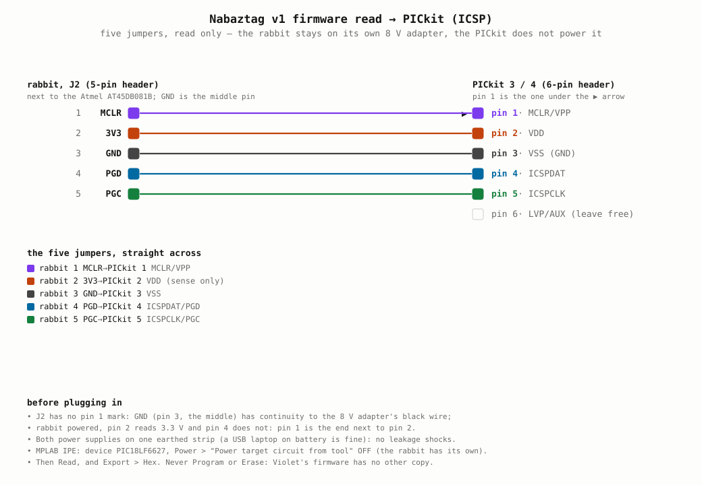

# Reading a Nabaztag v1's firmware (ICSP, J2)

A v1's program lives in its PIC18. Newbaztag read a PIC18F6627 (96 KB) and
published its 2.0b firmware; Clara's rabbit (Lazare, 1.4b) has a
**PIC18LF6525** (48 KB, device ID 0x0AE0, revision 1), read on 2026-11-24:
`dumps/violet-v1-1.4b.hex` (sha256 74a9d1be…), a second version of Violet's
firmware. Code protection off (CONFIG5L 0F, CONFIG5H C0), program up to
0xBFA7, the internal EEPROM blank (the settings live elsewhere), no
personal data in it. **Read only**: never Program or Erase, there is no
other copy of a given rabbit's firmware.

`./mkwiring.py -o wiring.svg` regenerates the picture from its table.

- J2 is MCLR, 3.3v, GND, PGD (RB7), PGC (RB6) in Violet's schematic (the FCC
  filing), the order of a PICkit's own pins 1 to 5: five wires straight
  across, PICkit pin 6 free.
- J2 has no pin-1 mark. GND is the middle pin (continuity to the 8 V
  adapter's black wire); with the rabbit powered, pin 2 reads 3.3 V: pin 1
  is the end next to it.
- The rabbit keeps its own 8 V adapter; in MPLAB IPE, "Power target circuit
  from tool" stays off. Both supplies on one earthed strip, or the laptop on
  battery: tying the grounds of two floating switch-mode supplies gave
  leakage shocks on the serial test (2026-11-22).
- `./read.sh <out.hex> [PIC18LF6525|PIC18LF6627]` (ipecmd, MPLAB X **6.20**:
  6.30 has no PICkit 3 support, its tool list stays empty; the device pack
  is found only after MPLAB IPE has been opened once). In the IPE window
  Export > Hex stayed greyed after a Read: the command line writes the file.
- A wrong device is refused with the ID read: 0x0AE0 is a PIC18(L)F6525,
  0x13C0 a PIC18(L)F6627 (the pack's `edc:DeviceIDSector`). The first Connect
  reloads the PICkit's own firmware for the PIC18 family; nothing reaches
  the rabbit.
- If it reads all zeros, Violet set code protection on this rabbit and the
  read stops there.
