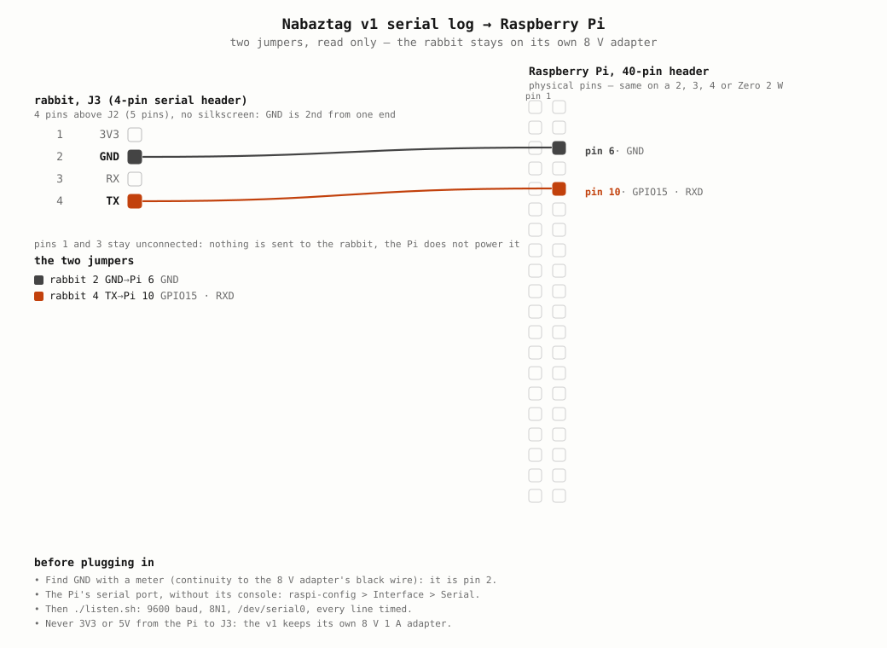

# A Nabaztag v1's serial log

The v1 (PIC18F6627, Violet's 2005 firmware) writes its log on UART1 at 9600
baud, on its 4-pin header J3, numbered as Violet's own schematic does (the FCC
filing, `../vendor/newbaztag/doc/schematics/schematics-630159.pdf`: 1 3.3v,
2 GND, 3 RX, 4 TX; Newbaztag's `components.md` lists them backwards):
the same lines the emulator prints (`uart: .WLAN04Terrier`, `../emulator/v1`).
Two jumpers to a Raspberry Pi read it, without sending anything to the rabbit.

- `mkwiring.py` draws `wiring.svg` from one table (made from `../jtag/mkwiring.py`).
- `listen.sh`, on the Pi: the log, each line timed, also kept in `~/v1-serial.log`.

J2, the 5-pin header just below it, is the PIC's ICSP (1 MCLR, 2 3.3v, 3 GND,
4 PGD, 5 PGC on the schematic): reading the
firmware there needs a programming voltage on MCLR that a Pi's GPIO cannot
give. Newbaztag read its v1 with a PICkit; ours runs firmware 1.4b (`v=14` in
its polls), the dump in `../vendor/newbaztag` is 2.0b (`v=20`).

The v1's adapter is 8 V, 1 A (`ALIM_8V_1A` on the schematic); it stays the
rabbit's only supply.
